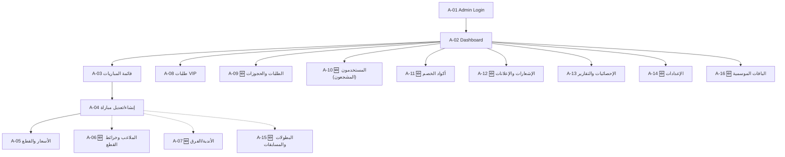
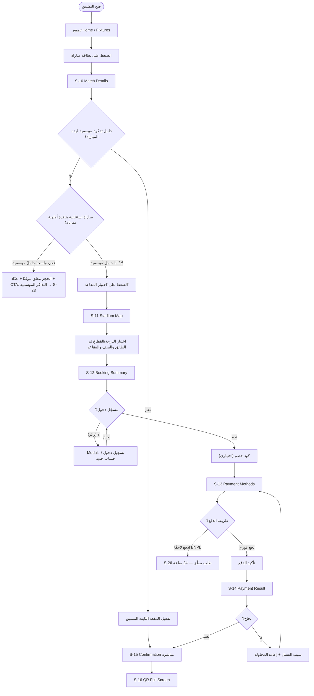
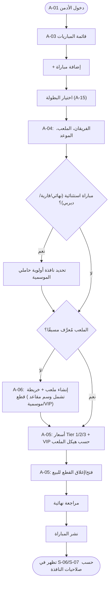

# UX Blueprint — منصة حجز مباريات كرة القدم (تطبيق + لوحة تحكم)

> **الحالة:** مرجع التصميم الأساسي — أضيفت له جولة إكمال حالات الواجهات (القسم 8)؛ اعتماد التسليم النهائي يتطلب مراجعة بصرية من صاحب المشروع.
> **الغرض:** هذا الملف هو **المصدر الأساسي الوحيد** لتصميم وبناء الشاشات، ويُبنى فوق `App Analytics.md` (الحصر الأولي للشاشات) و`Athletics Design System` (نظام التصميم المعتمد). لا يُلغي أيًا منهما، بل يوسّعهما إلى مستوى قابل للتنفيذ. قواعد انتقالات الحالات والتسليم موجودة في القسم 8، وملفا العرض الوحيدان داخل `design` هما البروتوتايب والـArtifact الكامل.
> **النطاق:** Sitemap كامل، User Flows بالشرح، Wireframes لكل شاشة، وحالات الواجهة الإضافية. المرحلة الحالية تصميم وتسليم للمطورين؛ لا تتضمن تطبيقًا تشغيليًا أو Backend أو اختبارات تشغيلية.
> **آخر تحديث:** جلسة قرارات 2026-09-03 — تم حسم كل الأسئلة المعلّقة (راجع القسم 5.3 "سجل القرارات المعتمدة")، وتصحيح أولوية اللغة (إنجليزي أساسي)، واعتماد فلسفة "بدون MVP".
> **فلسفة التنفيذ (توجيه صريح من صاحب المشروع):** لا يوجد نطاق مصغّر يؤجَّل بعده أي ميزة لمرحلة لاحقة. كل شاشة/ميزة مذكورة في هذا الملف **تُصمَّم كاملة من أول دفعة** — وليست نسخة أولية تُستكمل لاحقًا.

---

## 0. المنهجية ومصادر هذا الملف

| المصدر | الدور |
|---|---|
| `App Analytics.md` | الحصر الأولي: 22 شاشة تطبيق (S-01 → S-22) موزعة على 6 مستويات، + 5 وظائف للوحة التحكم بدون تفصيل شاشات. |
| `Athletics Design System` (`DESIGN (1).md`, `tokens.json`, `variables.css`, `theme.css`) | نظام تصميم "مونوجراف على مخمل أسود" — أحادي اللون تمامًا (Obsidian/Charcoal/Paper White/Ash)، خط عرض Serif خفيف (Feature Deck) وخط وظيفي Grotesque (Söhne)، بدون ظلال أو تدرجات أو ألوان تفاعلية. |
| جلسة القرارات (2026-09-03) | إجابات صاحب الفكرة على أسئلة النسخة الأولى من هذا الملف — أضافت نطاقًا جديدًا (تذاكر موسمية بمقعد ثابت، VIP بنوعين، BNPL بحجز مؤقت 24 ساعة، تعدد ملاعب/بطولات) وحسمت كل القرارات التصميمية المعلّقة. |

**منهجية البناء:** Sitemap ← User Flows ← Wireframes ← ملاحظات/فجوات، وكل إضافة غير موجودة بالحصر الأصلي معلّمة 🆕. الشاشات/العناصر الجديدة الناتجة عن جلسة القرارات مضافة بأرقام **جديدة تُلحق في آخر كل قائمة** (لم يُعَد ترقيم أي شاشة قديمة) لتفادي أي تعارض مرجعي مستقبلي.

---

## 1. Sitemap الكامل

### 1.1 خريطة تطبيق المستخدم (Fan App)

```mermaid
graph TD
  Splash["S-01 Splash"] --> Onboarding["S-02 Onboarding"]
  Onboarding --> Auth{"مسجّل دخول؟"}
  Auth -- "لا، عندي حساب" --> Login["S-03 Login"]
  Auth -- "لا، حساب جديد" --> Signup["S-04 Sign Up"]
  Auth -- "تصفح كضيف" --> MainTabs["Main Tab Bar"]
  Login --> ForgotPW["S-05 Forgot Password"]
  Login --> MainTabs
  Signup --> MainTabs

  MainTabs --> Home["S-06 Home"]
  MainTabs --> Fixtures["S-07 Fixtures"]
  MainTabs --> MyTickets["S-08 My Tickets"]
  MainTabs --> Profile["S-09 Profile"]

  Home --> MatchDetails["S-10 Match Details"]
  Fixtures --> MatchDetails
  MatchDetails --> StadiumMap["S-11 Stadium Map"]
  StadiumMap --> BookingSummary["S-12 Booking Summary"]
  BookingSummary --> PaymentMethods["S-13 Payment Methods"]
  PaymentMethods --> PaymentResult["S-14 Payment Result"]
  PaymentResult --> Confirmation["S-15 Confirmation"]
  Confirmation --> QRScreen["S-16 QR Full Screen"]
  MyTickets --> QRScreen

  Profile --> ManageClubs["S-17 Manage Clubs"]
  Profile --> Notifications["S-18 Notifications"]
  Profile --> HelpCenter["S-19 Help Center / FAQ"]
  Profile --> Settings["S-20 Settings"]
  Profile --> EditProfile["S-21 Edit Profile"]
  Settings --> Legal["S-22 Legal"]

  MatchDetails --> SeasonTickets["S-23 🆕 التذاكر الموسمية"]
  MatchDetails --> VIPRequest["S-24 🆕 طلب تجربة VIP"]
  Profile --> LoyaltyHistory["S-25 🆕 نقاط الولاء وكتالوج الاسترداد"]
  MyTickets --> PendingOrder["S-26 🆕 طلب معلّق (BNPL/VIP)"]
  VIPRequest -.-> PendingOrder
  PaymentMethods -.-> PendingOrder
  MainTabs --> Search["S-27 🆕 Search"]
  MyTickets --> Transfer["S-29 🆕 نقل/إهداء تذكرة"]
  BookingSummary --> GroupSplit["S-30 🆕 حجز جماعي / تقسيم الدفع"]
  Start -.-> SystemStates["S-28 🆕 حالات النظام (بدون اتصال / تحديث إجباري)"]
```



**ملاحظات بنيوية:**
- **اللغة الأساسية للتطبيق إنجليزية (LTR)** — تأكيد صريح من صاحب المشروع. العربية **خيار بديل** يُفعَّل من شاشة الإعدادات (S-20) ويقلب التخطيط بالكامل RTL (التبويب السفلي، الأسهم، المحاذاة) مع تبديل الخطوط — راجع القسم 4.4. كل مخطط في هذا الملف مرسوم بالوضع الافتراضي (إنجليزي/LTR).
- `Match Details` (S-10) و`QR Full Screen` (S-16) نقطتا التقاء بين أكثر من مسار — يُبنيان كشاشة واحدة قابلة للوصول من عدة نقاط، وليسا نسختين.
- **S-23 التذاكر الموسمية:** أصبحت شاشة كاملة (وليست مجرد زر داخل Match Details كما افترضت النسخة الأولى) لأنها **عملية شراء منفصلة تمامًا** (اختيار باقة → اختيار مقعد ثابت لموسم كامل → دفع) — راجع القسم 2.7.
- **S-24 طلب VIP:** شاشة جديدة لأن حجز VIP في هذا المنتج **ليس شراءً مباشرًا** بل طلبًا يمر على مراجعة الإدارة أولًا (يشمل نوعين: مقصورة VIP بخدمة متكاملة، أو كرسي VIP بالمقصورة الرئيسية) — راجع القسم 2.9.
- **S-25 نقاط الولاء:** رصيد وسجل وكتالوج استرداد كامل من دفعة التصميم الأولى — القرار المحدّث في القسم 5.1 هو المعتمد.
- **S-26 طلب معلّق:** شاشة موحّدة تُستخدم لحالتين: حجز BNPL (24 ساعة) وطلب VIP بعد الموافقة وقبل الدفع — إعادة استخدام نفس النمط بدل مكوّنين منفصلين.
- **S-27 Search، S-28 حالات النظام، S-29 نقل/إهداء تذكرة، S-30 حجز جماعي:** أربع شاشات/أنماط أُعيد تفعيلها كاملة (وليست أفكارًا مؤجلة كما في نسخة سابقة من هذا الملف) بعد توجيه "بدون MVP" — تفاصيلها في القسم 3.7.

### 1.2 خريطة لوحة تحكم الإدارة (Admin Panel)



| المعرف | الشاشة | من الأصل؟ | ملاحظة بعد جلسة القرارات |
|---|---|---|---|
| A-01 | Admin Login | 🆕 | دخول بدور صلاحيات (Super Admin / مدير مباريات / دعم / مالية) |
| A-02 | Dashboard | 🆕 | + عدّاد "طلبات VIP معلّقة" و"طلبات BNPL أوشكت على الانتهاء" |
| A-03 | قائمة المباريات | من الأصل | + فلتر حسب البطولة (دوري/كأس/قارية) |
| A-04 | إنشاء/تعديل مباراة | من الأصل | + حقل اختيار البطولة (A-15) + إعداد "نافذة أولوية حاملي التذكرة الموسمية" للمباريات الاستثنائية |
| A-05 | الأسعار والقطع | = الوظيفتان 2+3 الأصليتان | + تبويب تسعير فئة VIP (كرسي المقصورة الرئيسية) |
| A-06 | الملاعب وخرائط القطع | 🆕 فجوة حرجة أصلية | + وسم قطع كـ "مقاعد موسمية قابلة للتخصيص" و"مقاعد VIP"، + تعريف عدد/سعة مقصورات VIP |
| A-07 | الأندية/الفرق | 🆕 | بدون تغيير |
| A-08 | طلبات VIP | من الأصل | موسّعة الآن: نوع الطلب (مقصورة/كرسي)، عدد الضيوف، تسعير مخصص عند الموافقة → يفتح طلب دفع (S-26) |
| A-09 | الطلبات والحجوزات | 🆕 | + حالة "قيد الانتظار BNPL" مع عدّاد 24 ساعة، + استرجاع/إلغاء |
| A-10 | المستخدمون (المشجعون) | 🆕 | بدون تغيير |
| A-11 | أكواد الخصم | 🆕 | بدون تغيير |
| A-12 | الإشعارات والإعلانات | 🆕 | بدون تغيير |
| A-13 | الإحصائيات والتقارير | من الأصل | بدون تغيير |
| A-14 | الإعدادات | 🆕 | + إدارة بوابات الدفع المتعددة (تُحدد لاحقًا) |
| A-15 | 🆕 البطولات والمسابقات | 🆕 جديد كليًا | الدوري المصري، كأس مصر، كأس الرابطة، دوري أبطال أفريقيا، الكونفدرالية... إلخ — طبقة بيانات فوق "المباراة" |
| A-16 | 🆕 الباقات الموسمية | 🆕 جديد كليًا | تعريف باقات التذاكر الموسمية (نادٍ/ملعب/قسم/سعر) وربطها بمقاعد ثابتة قابلة للبيع |

---

## 2. User Flows الكاملة (بالشرح)

### 2.1 المسار الرئيسي: تصفح → حجز → دفع



**شرح النقاط الجديدة بعد جلسة القرارات:**
1. **حامل تذكرة موسمية (مؤكَّد):** يتخطى Stadium Map بالكامل — مقعده ثابت طوال الموسم (نفس الرقم/الصف)، فيذهب مباشرة لتأكيد الحضور.
2. **نافذة الأولوية 🆕:** للمباريات الاستثنائية غير المشمولة بالتذكرة الموسمية (نهائيات كأس، مباريات قارية، ديربيات)، يفتح الحجز أولًا لحاملي التذكرة الموسمية فقط لفترة يحددها الأدمن (A-04)، ثم يُفتح للجميع. غير حامل التذكرة يرى عدّاد تنازلي + دعوة لمعرفة التذاكر الموسمية (S-23) كترويج طبيعي (Upsell).
3. **BNPL (مؤكَّد):** عند اختيار "ادفع لاحقًا"، الحجز يدخل حالة **معلّقة لمدة 24 ساعة بالضبط** (حجز مؤقت للمقاعد يمنع بيعها لغيره خلال هذه الفترة)، ويظهر في My Tickets (S-08) بتبويب "قيد الانتظار" يقود لـ S-26. إن لم يُستكمل الدفع خلال 24 ساعة تُحرَّر المقاعد تلقائيًا. بوابات الدفع الفعلية (Tabby/Tamara أو غيرها) **قرار لاحق** ولا يؤثر على هذا التصميم.

### 2.2 مسار ثانوي: استخدام التذكرة عند البوابة
(بدون تغيير) — My Tickets (S-08) → QR Full Screen (S-16)، مع رفع سطوع تلقائي، منع قفل الشاشة، وعمل بدون إنترنت.

### 2.3 مسار ثانوي: الإشعارات
(بدون تغيير) — إشعار Push يقود مباشرة لمصدره (مباراة/تذكرة/نتيجة) عبر Deep Link، وليس لشاشة الإشعارات العامة.

### 2.4 مسار لوحة التحكم: تجهيز مباراة للبيع



**شرح:** الإضافة الوحيدة عن النسخة السابقة هي خطوة "اختيار البطولة" (لأن النطاق أصبح متعدد البطولات) وفرع "مباراة استثنائية" الذي يفعّل حقل نافذة الأولوية. باقي التسلسل (لا تسعير قبل خريطة ملعب، لا نشر قبل اكتمال الخطوتين) كما هو.

### 2.5 مسار لوحة التحكم: مراجعة طلب VIP (موسّع)
1. إشعار في A-02 Dashboard.
2. A-08 → فتح الطلب → يظهر **نوع الطلب** (مقصورة VIP كاملة الخدمة، أو كرسي VIP بالمقصورة الرئيسية) + عدد الضيوف + ملاحظات خاصة.
3. الأدمن يراجع التوافر (سعة المقصورات محدودة، من A-06) ويحدد **سعرًا نهائيًا** (التسعير غالبًا مخصص حسب عدد الضيوف والخدمات).
4. **موافقة** → يُنشأ طلب دفع في S-26 (نفس نمط BNPL، بمهلة يحددها الأدمن) + إشعار للمستخدم بالسعر النهائي. **رفض** → سبب اختياري + إشعار.
5. بعد إتمام الدفع: تذكرة عادية مؤكدة، مُعلَّمة "VIP" في S-08/S-15/S-16.

### 2.6 مسار لوحة التحكم: استرجاع/إلغاء حجز
(بدون تغيير) — A-09 بحث → تفاصيل → استرجاع/إلغاء بسبب إجباري → تحرير المقاعد تلقائيًا.

### 2.7 مسار جديد 🆕: شراء تذكرة موسمية
1. من S-09 Profile أو S-10 Match Details (رابط "عندك تذكرة موسمية؟") → **S-23 التذاكر الموسمية**.
2. تصفح الباقات المتاحة (فرز حسب النادي/الملعب/القسم) — كل باقة تعرض: نسبة التوفير مقارنة بالشراء المنفرد (كما أوضح صاحب المشروع أنها 30-40%)، وعدد المباريات المشمولة.
3. اختيار باقة → **اختيار مقعد ثابت** (يعيد استخدام مكوّن Stadium Map لكن يعرض فقط القطع المخصصة "موسمية"، والاختيار هنا **لمرة واحدة فقط لكامل الموسم**).
4. الدفع (يدعم تقسيط إن وُجد لاحقًا — خارج نطاق التصميم الحالي).
5. **إصدار "بطاقة عضوية موسمية"** — تصميم شبيه بـ S-15/S-16 لكن صالحة طوال الموسم، مع تذكير أن كل مباراة تحتاج "تفعيل" مسبق من Match Details (خطوة تأكيد حضور بسيطة، وليس إعادة اختيار مقعد) كما في المسار 2.1.
6. **ملاحظة نطاق:** خصومات متجر النادي الرسمي (مذكورة في إجابتكم) **خارج نطاق هذا التصميم حاليًا** — لا توجد شاشة متجر إلكتروني في هذا المنتج؛ إن أردتم تفعيلها مستقبلًا فهي تكامل منفصل (Phase 2) وليست جزءًا من تطبيق الحجز.

### 2.8 مسار جديد 🆕: إتمام/انتهاء طلب BNPL معلّق
1. المستخدم يرى بطاقة "قيد الانتظار" في S-08 مع عدّاد تنازلي (مثال: "متبقٍ 14 ساعة 22 دقيقة").
2. الضغط عليها → **S-26** → تفاصيل الحجز + [Pill Button] إكمال الدفع الآن → يعود لـ S-13.
3. لو انتهت الـ 24 ساعة بدون دفع: تُحرَّر المقاعد تلقائيًا، وتتحول البطاقة لحالة "ملغي (انتهت المهلة)"، مع إشعار للمستخدم.

### 2.9 مسار جديد 🆕: طلب تجربة VIP (من جهة المستخدم)
1. S-10 Match Details → CTA منفصل "تجربة VIP" (بجانب "اختيار المقاعد"، ليس بديلًا عنه).
2. **S-24** → اختيار النوع (مقصورة VIP بخدمة متكاملة / كرسي VIP بالمقصورة الرئيسية) → عدد الضيوف → ملاحظات → إرسال الطلب.
3. حالة "الطلب قيد المراجعة" تظهر في S-08 (تبويب قيد الانتظار) وS-18 الإشعارات.
4. عند موافقة الأدمن (2.5): إشعار بالسعر النهائي → S-26 لإتمام الدفع → تأكيد كأي تذكرة عادية، معلَّمة VIP.

---

## 3. Wireframes لكل الشاشات

### 3.1 مفتاح الرموز (Legend)

| الرمز | المكوّن | المصدر |
|---|---|---|
| `[Pill Button]` | زر أبيض مصمت، radius 9999px، نص أسود Söhne 16px | أصلي |
| `[Pill Button · Outline]` | نفس الشكل بحد Ash 1px بدل التعبئة | 🆕 مشتق |
| `[Charcoal Card]` | خلفية `#1d1d1d`، radius 8px، padding 24px، بدون ظل | أصلي |
| `[Hairline Divider]` | خط 1px `#d6d5d0` | أصلي |
| `[Form Input]` | حد سفلي فقط 1px Ash، نص أبيض Söhne 16px | أصلي |
| `[Specialty Tag]` | Pill أبيض/أسود صغير، يُستخدم كـ Chip فئة | أصلي |
| `[Bottom Tab Bar]` | خلفية Obsidian، حد علوي Hairline، أيقونة نشطة بيضاء/غير نشطة Ash 40% | 🆕 |
| `[Top App Bar]` | نسخة مصغّرة (56px) من Top Navigation الأصلي | 🆕 مشتق |
| `[Bottom Sheet]` | لوح منزلق، خلفية Charcoal، مقبض سحب، radius 8px للحافة العلوية | 🆕 |
| `[Data Table Row]` | صف بحد Hairline سفلي (لوحة التحكم) | 🆕 |
| `[KPI Stat Card]` | Charcoal Card برقم كبير Feature Deck | 🆕 |
| `[Status Marker]` | نص + رمز شكلي + شفافية — **بدون أي لون** (قرار نهائي، راجع 4.3) | 🆕 |
| `[Countdown Badge]` 🆕 | Pill بحد Ash، رقم عدّاد Söhne، لاستخدامه في S-26/S-08 لعدّاد BNPL | 🆕 |

> **اللغة الافتراضية إنجليزية/LTR** — الشاشات أدناه مرسومة بنفس اتجاه التنفيذ الفعلي الافتراضي (وليس للتوثيق فقط كما في نسخة سابقة). وضع العربية (اختياري من S-20) يقلب كل شاشة RTL مرآويًا بالكامل مع تبديل الخطوط — راجع 4.4.

### 3.2 قوالب التخطيط المتكررة

```
T1 · Tab Root          T2 · List              T3 · Detail
┌──────────────────┐   ┌──────────────────┐   ┌──────────────────┐
│ Top App Bar        │   │ Top App Bar + رجوع │   │ Top App Bar + رجوع│
│ محتوى قابل للتمرير  │   │ Search/Filter اختياري│  │ Hero/Media Block   │
│ (بطاقات، أقسام)     │   │ قائمة [Charcoal    │   │ أقسام معلومات       │
│                    │   │ Card] متكررة        │   │ (Hairline Divider)  │
├──────────────────┤   │ + تحميل تدريجي      │   │                    │
│ [Bottom Tab Bar]    │   └──────────────────┘   ├──────────────────┤
└──────────────────┘                            │ [Pill Button] ثابت  │
                                                 └──────────────────┘

T4 · Form               T5 · Result/Status      T6 · Interactive Canvas
┌──────────────────┐   ┌──────────────────┐    ┌──────────────────┐
│ Top App Bar         │   │                    │    │ Top App Bar شفاف   │
│ [Form Input] ×N      │   │      (مركزي)        │    │ فوق محتوى ملء الشاشة│
│ نص مساعد/خطأ          │   │  رمز/أيقونة حالة     │    │                    │
│                    │   │  عنوان Feature Deck  │    │  [Bottom Sheet]      │
│ [Pill Button]        │   │  وصف Söhne          │    │  منزلق من الأسفل     │
│ رابط ثانوي            │   │  [Pill Button]×1-2   │    │  (تفاصيل + CTA)      │
└──────────────────┘   └──────────────────┘    └──────────────────┘

T7 · Admin Data Table                T8 · Admin Dashboard
┌────────────────────────────┐      ┌────────────────────────────┐
│ Top App Bar + [+ إضافة جديد] │      │ Top App Bar                 │
│ Filters / Search              │      │ صف [KPI Stat Card] ×3-4      │
│ [Data Table Row] × N          │      │ رسوم بيانية أحادية اللون      │
│ Pagination                    │      │ [Data Table Row] مختصر أسفل  │
└────────────────────────────┘      └────────────────────────────┘
```

### 3.3 تطبيق المستخدم — S-01 → S-22 (بدون تغيير جوهري إلا المُشار إليه)

#### S-01 · Splash — T5
```
شعار التطبيق (مركزي) + اسم البطولة (Söhne 22) + ● ● ● مؤشر تحميل نابض أبيض/شفاف
```

#### S-02 · Onboarding — T5 (3 شرائح)
```
تخطي (أعلى) → صورة توضيحية → عنوان Feature Deck 48px 🆕 → وصف Söhne 16 → ●○○ → [التالي]
```

#### S-03 · Login — T4
```
عنوان "تسجيل الدخول" → [Form Input] هاتف/بريد → [Form Input] كلمة مرور 👁 → نسيت كلمة المرور؟ → [Pill Button] دخول → [Hairline] → إنشاء حساب
```

#### S-04 · Sign Up — T4
```
[Form Input] الاسم → [Form Input] الجوال → [Form Input] كلمة المرور → الفريق المفضل ▾ (Bottom Sheet قائمة أندية من A-07) → [Pill Button] إنشاء الحساب
```

#### S-05 · Forgot Password — T4 (3 خطوات)
```
[Form Input] الجوال → [Pill Button] إرسال الرمز | 🆕 [OTP ×4-6] | [Form Input] كلمة مرور جديدة+تأكيد → [Pill Button] حفظ
```

#### S-06 · Home — T1
```
صورة شخصية · "أهلاً {الاسم}" · 🔍 🔔 ← Top App Bar (🔍 يفتح S-27 Search)
"المباراة القادمة" (Söhne 22)
[Charcoal Card] شعار VS شعار · الوقت · الملعب · [Pill·Outline] حجز سريع (لحاملي الموسمية فقط)
[Hairline] → "توصيات ذكية" تمرير أفقي → "مباريات أخرى" عمودي
[Bottom Tab Bar] Home•نشط
```

#### S-07 · Fixtures — T2 (محدَّثة: فلتر بطولات)
```
"جدول المباريات" 🔍 (يفتح S-27 Search)
🆕 [Specialty Tag] فلتر بطولة: الدوري | كأس مصر | كأس الرابطة | أفريقيا (تمرير أفقي) — من A-15
🆕 [Calendar Strip] أسبوعي/شهري (مشتق من Specialty Tag متكررة)
[Specialty Tag] فلتر الجولة
قائمة [Charcoal Card] لكل مباراة (تعرض شارة اسم البطولة إن لم تكن الدوري المحلي)
[Bottom Tab Bar] Fixtures•نشط
```

#### S-08 · My Tickets — T2 (محدَّثة: تبويب قيد الانتظار)
```
"تذاكري"
[Specialty Tag] قادمة | 🆕 قيد الانتظار | سابقة | ملغية (Segmented)
تبويب قيد الانتظار: [Charcoal Card] + [Countdown Badge] "متبقٍ 14:22:03" → S-26
تبويب قادمة/سابقة: [Charcoal Card] بشعار البطولة + QR مصغّر، وشارة "VIP" أو "موسمية" إن انطبقت
[Bottom Tab Bar] Tickets•نشط
```

#### S-09 · Profile — T1 (محدَّثة: رابط نقاط الولاء)
```
صورة + الاسم
🏆 نقاط الولاء: 1,240 → S-25 🆕
[Hairline] → الأندية المفضلة→S-17 | الإشعارات→S-18 | المساعدة→S-19 | الإعدادات→S-20 | تعديل الملف→S-21
🆕 رابط: "عندك تذكرة موسمية؟ اعرف أكتر" → S-23 (لغير حاملي الموسمية، ترويجي)
[Bottom Tab Bar] Profile•نشط
```

#### S-10 · Match Details — T3 (محدَّثة: VIP + نافذة أولوية)
```
صورة الملعب (Hero) ← شعارا الفريقين · VS · التاريخ/الوقت · الملعب · اسم البطولة (من A-15)
[Hairline] → التصنيف الجماهيري → نطاق الأسعار حسب هيكل الملعب (Tier 1/2/3) + 🆕 VIP
🆕 إن كان موسميًا: [Charcoal Card] "مقعدك: صف 4 – مقعد 12"
🆕 إن كانت نافذة أولوية نشطة وغير حامل موسمية: [Charcoal Card] "الحجز يفتح للجميع خلال 06:12:40" + [Pill·Outline] اعرف عن التذاكر الموسمية → S-23
[Pill Button] اختيار المقاعد
🆕 [Pill Button·Outline] تجربة VIP → S-24 (منفصل، ليس بديلاً)
```

#### S-11 · Stadium Map — T6 (محدَّثة: قطاع VIP)
```
خريطة 2D تفاعلية (قرار نهائي 2D — راجع 5.2)
[Status Marker]: ● متاح (تعبئة كاملة+نص) │ ▨ مباع (تهشير+نص) │ ✕ مغلق (شفافية 30%+نص)
🆕 قطاع VIP مميّز بإطار مزدوج (Hairline مضاعف) بدل أي لون + تسمية "VIP" نصية واضحة
[Bottom Sheet]: الفئة + عدد المقاعد + السعر الإجمالي → [Pill Button] متابعة
```

#### S-12 · Booking Summary — T4/T3
```
قائمة المقاعد المختارة → العدد → السعر الإجمالي → [Form Input] كود خصم + [Pill·Outline] تطبيق → [Pill Button] متابعة للدفع
```

#### S-13 · Payment Methods — T2 (محدَّثة: BNPL)
```
[Charcoal Card] بطاقات محفوظة + [Pill·Outline] إضافة بطاقة (Bottom Sheet)
[Charcoal Card] محفظة إلكترونية
🆕 [Segmented] ادفع الآن | ادفع لاحقًا (خلال 24 ساعة) — عند اختيار الثاني: نص توضيحي "سيُحجز مقعدك مؤقتًا 24 ساعة، ثم يُلغى تلقائيًا إن لم يتم السداد"
[Pill Button] ادفع الآن {المبلغ} / تأكيد الحجز المؤقت
```

#### S-14 · Payment Result — T5
```
نجاح: ✓ + احتفال بصري أحادي اللون + [Pill Button] متابعة
فشل: ✕ + سبب الفشل + [Pill Button] إعادة المحاولة + [Pill·Outline] تغيير طريقة الدفع
```

#### S-15 · Confirmation — T5
```
رقم الطلب + تفاصيل المقاعد + تعليمات الدخول + شارة "VIP"/"موسمية" إن انطبقت + [Pill Button] عرض التذكرة → S-16
```

#### S-16 · QR Full Screen — T5
```
QR كبير على خلفية بيضاء (الاستثناء الوحيد المقبول من قاعدة monochrome، للتباين مع الماسح) + اسم المباراة/التاريخ
سلوك: رفع سطوع تلقائي + منع قفل الشاشة + عمل بدون إنترنت
```

#### S-17 · Manage Clubs — T2
```
[Charcoal Card] لكل نادٍ: شعار + اسم + [Toggle] متابعة (تعبئة بيضاء = نشط، بدون لون)
```

#### S-18 · Notifications — T2
```
تجميع زمني (اليوم/أمس/أقدم) → [Data Table Row]: أيقونة + نص + وقت + نقطة "غير مقروء" بيضاء صغيرة
```

#### S-19 · Help Center / FAQ — T2
```
[Form Input] بحث → 🆕 [Accordion] أسئلة شائعة → [Pill Button] تواصل مع الدعم
```

#### S-20 · Settings — T2
```
اللغة عربي/EN [Segmented] → الخصوصية → إشعارات Push [Toggle] → الصفحات القانونية→S-22 → [Pill·Outline] تسجيل الخروج
```

#### S-21 · Edit Profile — T4
```
صورة + [Pill·Outline] تغيير → [Form Input] الاسم/الهاتف → تغيير كلمة المرور → [Pill Button] حفظ
```

#### S-22 · Legal — T3
```
[WebView] محتوى من A-14 (الصفحات القانونية)
```

### 3.4 تطبيق المستخدم — الشاشات الجديدة 🆕

#### S-23 · التذاكر الموسمية — T2 + T6 مختلط
```
"التذاكر الموسمية"
[Charcoal Card] لكل باقة: اسم النادي/الملعب + نطاق القسم + السعر + "وفّر حتى 40%" [Specialty Tag]
عند الاختيار → خريطة الملعب (نفس مكوّن S-11) لكن **مقيّدة على القطع الموسمية فقط** + اختيار مقعد نهائي (لمرة واحدة)
→ S-13 الدفع → إصدار بطاقة عضوية (تصميم شبيه بـ S-15، صالحة طوال الموسم)
```
ملاحظة: خصومات متجر النادي **خارج نطاق هذا التصميم** (راجع 2.7).

#### S-24 · طلب تجربة VIP — T4
```
"تجربة VIP"
[Segmented] مقصورة VIP (خدمة متكاملة) | كرسي VIP (المقصورة الرئيسية)
عدد الضيوف [Stepper] 🆕 (زر −/+ بدون لون، رقم Söhne بالمنتصف)
[Form Input] ملاحظات/طلبات خاصة (نص حر)
نطاق سعري تقديري (نص توضيحي: "السعر النهائي يُحدَّد بعد المراجعة")
[Pill Button] إرسال الطلب → حالة "قيد المراجعة" في S-08/S-18
```

#### S-25 · نقاط الولاء وكتالوج الاسترداد — T2 (نسخة كاملة، راجع 5.1)
```
"Loyalty"
[Specialty Tag] Balance | History | Redeem (Segmented)
تبويب Balance: الرقم كبير أعلى (Feature Deck) + شريط تقدم للمستوى التالي (حد Ash، بدون تلوين)
تبويب History: [Data Table Row]-ستايل زمني — "+10 pts · Al Ahly match booking · Aug 12"
تبويب Redeem: شبكة [Charcoal Card] مكافآت (خصم على الحجز القادم، أولوية حجز، ترقية فئة مقعد) — كل بطاقة بعدد النقاط المطلوب + [Pill·Outline] Redeem (يُعطَّل بنص باهت إن كان الرصيد غير كافٍ، بدون لون تحذيري)
```

#### S-26 · طلب معلّق (BNPL / VIP) — T5
```
عنوان: "طلبك قيد الانتظار"
[Countdown Badge] كبير مركزي — عدّاد تنازلي
تفاصيل الحجز (المقاعد/الخدمة، المبلغ المطلوب)
[Pill Button] إكمال الدفع الآن → S-13
[Pill·Outline] إلغاء الطلب
نص تحذيري: "سيُلغى الحجز تلقائيًا وتُحرَّر المقاعد عند انتهاء المهلة"
```

### 3.5 لوحة التحكم — A-01 → A-14 (بدون تغيير إلا المُشار إليه)

#### A-01 · Admin Login — T4
```
[Form Input] البريد الإداري → [Form Input] كلمة المرور → [Pill Button] دخول → 🆕 2FA اختياري
```

#### A-02 · Dashboard — T8
```
[KPI Stat Card] مبيعات اليوم │ مباريات قادمة │ 🆕 طلبات VIP معلّقة │ 🆕 طلبات BNPL أوشكت على الانتهاء
رسم بياني: مبيعات آخر 7 أيام (خط أبيض، بدون تعبئة لونية)
[Data Table Row] مختصر: آخر 5 حجوزات + مباريات أوشكت على الامتلاء
```

#### A-03 · قائمة المباريات — T7 (محدَّثة)
```
+ إضافة مباراة | بحث | 🆕 فلتر البطولة (من A-15) | فلتر الحالة
[Data Table Row]: الفريقان | البطولة | التاريخ | الملعب | الحالة | نسبة الإشغال | ⋮
```

#### A-04 · إنشاء/تعديل مباراة — T4 (محدَّثة)
```
🆕 البطولة ▾ (من A-15) | الفريق المضيف ▾ | الفريق الضيف ▾ (من A-07)
الملعب ▾ (من A-06) | التاريخ/الوقت
🆕 [Toggle] مباراة استثنائية (نهائي/قارية/ديربي) → عند التفعيل: [Form Input] موعد فتح الأولوية لحاملي الموسمية | موعد الفتح العام
حالة: مسودة/منشورة [Toggle]
[Pill Button] التالي: الأسعار والقطع → A-05
```

#### A-05 · الأسعار والقطع — T4 (محدَّثة: تبويب VIP)
```
[تبويب الأسعار]: درجات Tier 1/2/3 بحسب الملعب [Form Input] سعر لكل درجة | 🆕 فئة VIP (كرسي المقصورة) [Form Input] سعر
[تبويب القطع]: خريطة الملعب → [Toggle] فتح/إغلاق لكل قطعة → نسبة إشغال نصية
[Pill Button] حفظ ونشر (يُفعَّل بعد اكتمال الخطوتين)
```

#### A-06 · الملاعب وخرائط القطع — T7 + محرر مخصص (محدَّثة)
```
+ إضافة ملعب | [Data Table Row] قائمة الملاعب
عند الفتح: [Section Map Builder] — قرار نهائي: **2D فقط للإصدار الأول** (راجع 5.2)
  رسم/تسمية كل قطعة + سعتها
  🆕 وسم قطعة كـ: عادية | موسمية قابلة للتخصيص | VIP
  🆕 لقطع VIP من نوع "مقصورة": تعريف عدد المقصورات وسعة كل مقصورة (أفراد)
  حفظ كقالب لإعادة الاستخدام
```

#### A-07 · الأندية/الفرق — T7
```
+ إضافة نادٍ | [Data Table Row]: الشعار | الاسم | عدد المتابعين | ⋮
```

#### A-08 · طلبات VIP — T7 + T3 (محدَّثة بالكامل)
```
قائمة: [Data Table Row]: الاسم | المباراة | 🆕 نوع الطلب (مقصورة/كرسي) | عدد الضيوف | الحالة
تفاصيل الطلب: بيانات الطالب + الملاحظات + توافر السعة (من A-06)
🆕 [Form Input] السعر النهائي (تسعير مخصص) + 🆕 [Form Input] مهلة الدفع (ساعات)
[Pill Button] قبول (→ ينشئ طلب دفع S-26) | [Pill·Outline] رفض
```

#### A-09 · الطلبات والحجوزات — T7 + T3 (محدَّثة)
```
بحث برقم الطلب/الهاتف/البريد → [Data Table Row]: رقم الطلب | العميل | المباراة | المبلغ | 🆕 الحالة (مؤكد/قيد انتظار BNPL/ملغي)
🆕 لحجوزات BNPL: عرض الوقت المتبقي من المهلة
تفاصيل: كل المقاعد + سجل الدفع + [Pill·Outline] استرجاع | إعادة إرسال التذكرة
```

#### A-10 · المستخدمون — T7 + T3
```
[Data Table Row]: الاسم | الهاتف | تاريخ التسجيل | عدد الحجوزات | 🆕 عضو موسمي؟ (نعم/لا)
تفاصيل: سجل الحجوزات + [Pill·Outline] تجميد الحساب
```

#### A-11 · أكواد الخصم — T7
```
+ إنشاء كود | [Data Table Row]: الكود | القيمة | الصلاحية | الاستخدامات | الحالة
```

#### A-12 · الإشعارات والإعلانات — T4 + T7
```
+ إشعار جديد: العنوان + النص + الاستهداف (الكل/متابعو نادٍ/حاملو تذكرة مباراة/🆕 حاملو تذاكر موسمية) + جدولة
سجل الإشعارات المُرسلة
```

#### A-13 · الإحصائيات والتقارير — T8
```
[تبويب الرسوم]: نسب حضور | مبيعات حسب الفئة (بما فيها VIP) | اتجاه المبيعات
[تبويب التقارير]: [Data Table Row] تقارير جاهزة + [Pill·Outline] تصدير CSV/PDF
```

#### A-14 · الإعدادات — T4 (محدَّثة)
```
[عام]: اسم المنصة | 🆕 بوابات الدفع المتعددة (إدارة/تفعيل — التفاصيل تُحدد لاحقًا) | وضع الصيانة [Toggle]
[الفريق والصلاحيات]: [Data Table Row] أعضاء الفريق + الدور + [Pill Button] دعوة عضو
[المحتوى القانوني]: محرر نصي → يغذّي S-22
```

### 3.6 لوحة التحكم — الشاشات الجديدة 🆕

#### A-15 · البطولات والمسابقات — T7
```
+ إضافة بطولة | [Data Table Row]: الاسم | النوع (محلي/قاري) | الموسم | عدد المباريات | الحالة
مثال بيانات: الدوري المصري الممتاز | كأس مصر | كأس رابطة المحترفين | دوري أبطال أفريقيا | الكونفدرالية الأفريقية
```

#### A-16 · الباقات الموسمية — T7 + T4
```
+ باقة جديدة: النادي ▾ | الملعب ▾ (A-06) | القسم/القطاع ▾ | السعر | عدد المباريات المشمولة
[Data Table Row]: قائمة الباقات + عدد المقاعد المباعة/المتاحة لكل باقة (من إجمالي سعة القطاع الموسمي في A-06)
```

---

### 3.7 تطبيق المستخدم — دفعة إضافية 🆕 (مُفعَّلة كاملة بعد توجيه "بدون MVP")

#### S-27 · Search — T2
```
"Search"
[Form Input] search by team / stadium / competition
Recent searches — [Specialty Tag] chips
Results: [Charcoal Card] list (same style as Fixtures cards)
Empty state: "No matches found" + [Pill Button] Browse Fixtures
```
نقطة الدخول: أيقونة 🔍 في Top App Bar لشاشتي Home (S-06) وFixtures (S-07).

#### S-28 · حالات النظام (نمط عابر، وليس شاشة واحدة) — T5
```
No Internet: icon + "You're offline" + [Pill Button] Retry
Force Update: icon + "Update required to continue" + [Pill Button] Update Now (يفتح المتجر)
Empty State (نمط مضمّن داخل T1/T2، وليس شاشة كاملة): icon + رسالة + CTA اختياري
  — يُستخدم في: Home (لا فريق مفضل) · Fixtures (لا مباريات) · My Tickets (لا تذاكر) · Search (لا نتائج)
```
هذه أنماط عابرة (Cross-cutting Patterns) يجب توثيقها مرة واحدة والالتزام بها في كل شاشة تحتاجها، بدل اجتهاد منفصل لكل شاشة.

#### S-29 · نقل/إهداء تذكرة — T3/T4
```
من تفاصيل تذكرة مؤكدة في S-08 → إجراء "Transfer / Gift"
"Transfer Ticket"
[Form Input] Recipient phone or email
رسالة تأكيد + [Pill Button] Send Transfer
```
مسار المستلم: يصله إشعار/رابط → يقبل → تنتقل التذكرة لحسابه ويُبطَل QR الأصلي لدى المُرسِل تلقائيًا.

#### S-30 · حجز جماعي / تقسيم الدفع — امتداد لـ T4 داخل S-12
```
داخل Booking Summary (S-12) عند اختيار مقعدين أو أكثر:
🆕 [Toggle] "Split payment with friends"
عند التفعيل: حقل هاتف/بريد لكل مقعد → [Pill Button] Send payment requests
كل مشارك يستلم رابطًا ويدفع نصيبه عبر S-13 الخاصة به → يكتمل الطلب عند اكتمال كل الأنصبة
```

---

## 4. قرارات نظام التصميم (Athletics DS) — نهائية بعد جلسة القرارات

### 4.1 مكوّنات "تطبيق" غير موجودة أصلًا
Bottom Tab Bar، Top App Bar مصغّر، Bottom Sheet، Data Table، KPI Card، Toggle، Accordion، OTP Input، Calendar، Countdown Badge، Stepper — كلها **معتمدة الآن** كإضافات مشتقة حصريًا من نفس الرموز الأربعة، نفس نصف القطر (8px/9999px)، ونفس سلّم المسافات (8px base) — **بدون أي لون أو ظل جديد**.

### 4.2 سلّم الطباعة للموبايل — **معتمد نهائيًا**
- `--text-caption: 12px` (Söhne 400) — تسميات صغيرة/شارات.
- `--text-body-xs: 14px` (Söhne 400) — نصوص ثانوية.
- سقف Feature Deck **48px فقط** لعناوين شاشات الموبايل (بدل 72-116px، المحفوظة لأي واجهة هيرو تسويقية مستقبلية).

### 4.3 حالات وظيفية بدون ألوان — **قرار نهائي: لا استثناء لوني، الحل الطبقي معتمد**
**القرار:** الالتزام الكامل بقاعدة "Zero chromatic color" في `DESIGN (1).md` دون أي استثناء. السبب: هذا القيد هو جوهر هوية Athletics التحريرية التي اخترتموها تحديدًا لهذا المشروع ("لا اخرج عنه تماما") — أي استثناء لوني (ولو بلونين فقط) يكسر الاتساق الذي يميّز المنتج عن أي تطبيق حجز تذاكر عادي، وأنظمة حجز المدرجات التقليدية (مسارح/طائرات) تستخدم فعليًا نفس منطق (نص + رمز شكلي + كثافة) بنجاح دون الاعتماد على اللون وحده — وهو أيضًا أفضل لإمكانية الوصول (Accessibility) لمستخدمي عمى الألوان.
**التطبيق:** ثلاث طبقات معًا دائمًا (وليس طبقة واحدة): نص صريح + رمز شكلي (دائرة/تهشير/علامة) + شفافية/كثافة السطح. أُضيف الآن **نمط تهشير قطري (Diagonal Hatch)** للمقاعد المباعة تحديدًا في S-11 — معيار شائع في خرائط المسارح/الملاعب، أحادي اللون بالكامل.

### 4.4 اللغة والخطوط — **قرار نهائي محدَّث** (تصحيح أولوية اللغة)
**اللغة الأساسية إنجليزية (LTR)** — تأكيد صريح من صاحب المشروع، والعربية خيار بديل من S-20 فقط. هذا يعكس ترتيب النسخة السابقة من الملف.

**الوضع الافتراضي (إنجليزي/LTR):** يُستخدم النظام الأصلي كما هو تقريبًا، ببدائل إنتاجية فعلية مأخوذة بروح قائمة البدائل في `DESIGN (1).md` (متاحة كخطوط ويب حقيقية عبر Google Fonts، بدون تكلفة):
- بديل **Feature Deck**: **Newsreader** (وزن 300، Optical Size كبير 72-96) — سيريف تحريري خفيف الوزن بنفس روح "الوزن الخفيف = سلطة بالتقشف"، واختيار أقل شيوعًا من البدائل المعتادة (Fraunces) لتفادي طابع "تصميم AI نمطي".
- بديل **Söhne**: **IBM Plex Sans** (وزن 300/400) — بدل Inter، لسبب تصميمي مهم: نفس عائلة **IBM Plex** لها نسخة عربية رسمية بنفس الأوزان والمنطق (راجع وضع العربية أدناه)، فيبقى الانتقال بين اللغتين متسقًا بصريًا بدرجة أكبر من مزج عائلتين مختلفتين تمامًا.

**وضع العربية (بديل، يُفعَّل من S-20):** انعكاس RTL كامل (التبويب السفلي، الأسهم، المحاذاة) + تبديل الخطوط:
- بديل Feature Deck: **Noto Serif Arabic** (Light 300).
- بديل Söhne: **IBM Plex Sans Arabic** (300/400) — نفس عائلة IBM Plex المستخدمة بالإنجليزية.

الخطوط الأربعة مجانية بالكامل عبر Google Fonts. بنية الـ Grid تُبنى **LTR-first** (الوضع الافتراضي)، مع دعم RTL كامل كوضع بديل مرآوي.

### 4.5 نموذج بيانات درجات الملعب — واقعي 100% (بحث ميداني)

بتوجيه من صاحب المشروع (خبرة مباشرة بملاعب مصر)، استبدلنا نظام الفئات العام (A/B/C) بنموذج مطابق للهيكل الفعلي لملاعب كرة القدم المصرية — تأكد بالبحث (Wikipedia + تقارير صحفية 2026) ومطبَّق الآن في S-11 وA-06 وA-05 وكل الشاشات المرتبطة:

**الهيكل الحقيقي (مثال: استاد القاهرة الدولي):**
- **الدرجة الأولى (Tier 1)** — المدرجات المواجهة للملعب مباشرة (خط المنتصف)، أعلى سعر، تشمل عادة قطاع VIP مركزي.
- **الدرجة الثانية (Tier 2)** — عند "الكيرف" (زوايا المدرج)، مقسّمة يمين/يسار.
- **الدرجة الثالثة (Tier 3)** — خلف المرميين (نهايتا الملعب)، أقل سعر، مقسّمة يمين/يسار.
- **كل درجة** يمكن أن تكون مقسّمة **علوي/سفلي** (طابقين) — لكن **ليس كل الملاعب بهذا الشكل**: بعض الملاعب الأصغر دور واحد فقط (بدون تقسيم علوي/سفلي).

**النموذج البرمجي المقترح (للباك اند لاحقًا):** كل ملعب له عدد درجات مستقل (1-3)، وكل درجة لها Boolean مستقل لكل من "علوي/سفلي" و"يمين/يسار" — وليس افتراضًا ثابتًا لكل الملاعب. هذا بالضبط ما تعرضه شاشة A-06 (الملاعب وخرائط القطع) الآن: عمود "Tier Structure" يوضح عدد الدرجات ونوع التقسيم لكل ملعب على حدة.

**بيانات حقيقية مستخدمة في الـ Mockups (بحث تم في 2026-09-03):**
| الملعب | السعة الحقيقية | المدينة | الأندية |
|---|---|---|---|
| استاد القاهرة الدولي | 75,000 | مدينة نصر، القاهرة | الأهلي، الزمالك (كلاهما فعليًا لموسم 2025-26/2026-27) |
| استاد 30 يونيو | 30,000 | التجمع الخامس، القاهرة | بيراميدز، وادي دجلة |
| استاد برج العرب | 86,000 | الإسكندرية | المصري (وأكبر ملعب بمصر/أفريقيا سعةً) |
| استاد الإسماعيلية | 35,000 | الإسماعيلية | الإسماعيلي (مثال درجة واحدة فقط) |

الأندية العشرون المشاركة فعليًا في الدوري المصري الممتاز 2026-2027 (المصدر: بوابة الأهرام، يلاكورة): الأهلي، الزمالك، بيراميدز، سيراميكا كليوباترا، المصري، إنبي، سموحة، زد، وادي دجلة، المقاولون العرب، الاتحاد السكندري، غزل المحلة، الجونة، بتروجت، البنك الأهلي، مودرن سبورت، طلائع الجيش، القناة، بترول أسيوط، أبو قير للأسمدة.

**تحديث بصري (2026-09-03):** بناءً على طلب صاحب المشروع، خريطة الملعب (S-11 وشاشتها المرآة في لوحة التحكم A-05) أعيد رسمها بشكل بيضاوي واقعي: **الملعب أفقي (Landscape)** بدل الرأسي، والمدرجات **منحنية/بيضاوية حول المستطيل** (مش صناديق مربعة كسابقًا) — نفس أسلوب رسم استاد Onboarding (S-02) بالظبط لكن كخريطة تفاعلية حقيقية بـ8 قطاعات إهليلجية دقيقة (Tier1×2, Tier2×4, Tier3×2). كمان اتضاف **شعارا الناديين** (نفس شكل الدرع التجريدي المستخدم بكل التطبيق) داخل الملعب بجانب كل مرمى.

**ملاحظة مهمة عن الشعارات:** هذا وصف لمرحلة أولى من التصميم؛ القرار الأحدث رقم 18 في سجل القرارات هو المعتمد. توجد الآن شعارات أندية وبطولات فعلية سلّمها صاحب المشروع ودُمجت في الواجهات، مع بدائل تجريدية لما لم يُسلَّم بعد. يجب تثبيت حق استخدام الأصول عند الانتقال للإنتاج.

---

## 5. ملاحظات وتحسينات إضافية

### 5.1 نقاط الولاء — **قرار محدَّث: كتالوج استرداد كامل من أول دفعة**
بتوجيه صريح من صاحب المشروع بعدم اعتماد مبدأ MVP، تراجعت عن القرار المبدئي بالتبسيط. S-25 الآن 3 تبويبات كاملة (الرصيد/السجل/الاسترداد) بمكافآت مرتبطة مباشرة بمنتج الحجز (خصومات، أولوية حجز، ترقية فئة) مصمَّمة بالكامل الآن، مع ترك قواعد الاحتساب الدقيقة (نقاط لكل جنيه/حجز) لمرحلة الباك اند.

### 5.2 تعقيد خريطة الملعب — **قرار نهائي: تفاعل 2D + تنفيذ بصري بمستوى Isometric فاخر**
هذا قرار **هندسي وليس تبسيطًا للميزة**: خرائط 3D تفاعلية فعلية (محرك 3D، نمذجة مخصصة لكل استاد) مخاطرة زمنية وتقنية ضخمة لا تتناسب مع كونها عنصرًا أساسيًا يُستخدم يوميًا. البديل المعتمد يحقق نفس الطموح البصري **بدون** محرك 3D: رسم Isometric عالي الدقة (2.5D) لكل قطاع — نفس المعيار المستخدم في أضخم منصات حجز التذاكر عالميًا — مع تكبير Zoom لتفاصيل الصفوف. هذا لا يتعارض مع توجيه "بدون MVP" لأن الميزة (رؤية واختيار أي مقعد بدقة) مكتملة بالكامل؛ المتغيّر هو تقنية العرض فقط.

### 5.3 سجل القرارات المعتمدة (Decision Log)

| # | القرار | الأثر على التصميم |
|---|---|---|
| 1 | التذكرة الموسمية = مقعد ثابت طوال الموسم (وليس خصمًا فقط) + أولوية شراء لمباريات استثنائية غير مشمولة | إضافة S-23 (شراء)، منطق "تخطي اختيار المقعد" في المسار الرئيسي، "نافذة أولوية" في S-10/A-04 |
| 2 | BNPL مؤكدة، حجز مؤقت 24 ساعة، بوابات الدفع تُحدد لاحقًا | إضافة S-26، تبويب "قيد الانتظار" في S-08، حالة BNPL في A-09 |
| 3 | VIP بنوعين: مقصورة خدمة متكاملة + كرسي بالمقصورة الرئيسية، عبر طلب ومراجعة إدارية | إضافة S-24، توسيع A-08 (تسعير مخصص)، وسم قطع VIP في A-06 |
| 4 | النطاق: عدة ملاعب + عدة بطولات (محلية وقارية) داخل دولة واحدة (مثال: مصر) | إضافة A-15 البطولات، فلتر بطولة في S-07/A-03، حقل بطولة في A-04 |
| 5 | حالات بدون ألوان: معتمد بدون استثناء | راجع 4.3 |
| 6 | خط عربي: Noto Serif Arabic + IBM Plex Sans Arabic | راجع 4.4 |
| 7 | سلّم طباعة موبايل موسّع (12/14/48px) | راجع 4.2 |
| 8 | خريطة الملعب 2D للإصدار الأول | راجع 5.2 |
| 9 | نقاط الولاء: كتالوج استرداد كامل من أول دفعة (محدَّث) | راجع 5.1 |
| 10 | اللغة الأساسية إنجليزية/LTR، العربية بديل RTL (تصحيح) | راجع 1.1، 3.1، 4.4 |
| 11 | لا مبدأ MVP — كل ميزة تُصمَّم كاملة من أول دفعة | راجع الشعار أعلى الملف، وS-25 وS-27..S-30 |
| 12 | نموذج بيانات درجات الملعب الحقيقي (Tier/Deck/Side) بدل A/B/C العام، مبني على هيكل ملاعب مصر الفعلي | راجع القسم 4.5 |
| 13 | استخدام أندية وملاعب مصرية حقيقية بالاسم (بيانات واقعية) مع شعارات تجريدية غير حقيقية (تفادي مشاكل الملكية الفكرية) | راجع القسم 4.5 |
| 14 | خريطة الملعب (S-11/A-05) أُعيد رسمها بيضاويًا (ملعب أفقي + مدرجات منحنية حول المستطيل) بدل الصناديق المربعة، بشعاري الفريقين داخل الملعب | راجع القسم 4.5 |
| 15 | الاسم النهائي "تذاكر" (Tazakir) — قرار صاحب المشروع، ثابت في كل الشاشات كنص حتى داخل جمل إنجليزية | 2026-09-03 |
| 16 | صاحب المشروع سلّم أصول حقيقية فعليًا: لوجو Vector (SVG+PNG، Dark/Light)، أيقونة تطبيق 1024×1024، شعارَي الأهلي والزمالك الرسميين — كلها مُدمَجة الآن في التصميم | 2026-09-03، راجع القسم 7 |
| 17 | **قاعدة معتمدة لباقي المشروع:** أي عنصر في الـ Mockup له مقابل فعلي حقيقي (زي رمز QR) لازم يتولّد بأداة حقيقية مش يترسم يدويًا تقريبيًا — لأن كل حاجة تتعرض على العميل وتتوافق عليها هتتنفذ حرفيًا. رمز QR بشاشة S-16 اتولّد فعليًا بمكتبة `qrcode` (Node.js) ومُشفَّر فيه رابط تحقق تجريبي، مش نمط مرسوم يدويًا | 2026-09-03 |
| 18 | صاحب المشروع سلّم أصولًا حقيقية إضافية: شعارات رسمية لـ 8 أندية مصرية أخرى (بيراميدز، الاتحاد السكندري، سيراميكا كليوباترا، الأهلي/غزل المحلة، سموحة، طلائع الجيش، زد إف سي، المصري) + شعار الاتحاد الأفريقي لكرة القدم (CAF) + شعار "دوري نايل" (الاسم التجاري للدوري المصري الممتاز). دُمجت في: A-07 (كتالوج أندية موسّع لـ11 ناديًا)، S-17/إدارة الأندية (نفس الموسّع)، A-15 البطولات (شعارَي الدوري وCAF)، وشعار البطولة المناسب (دوري نايل للمحلي، CAF للقاري) يظهر الآن على بطاقات المباريات في S-06/S-07/S-10/A-03. هذا **يُلغي جزئيًا القرار #13** بخصوص الشعارات التجريدية: الآن 10 أندية (كل ما سبق + الأهلي والزمالك) لها شعارات حقيقية؛ إسماعيلي فقط ما زال بشعار تجريدي (لا يوجد أصل حقيقي مُسلَّم له بعد) | 2026-09-03، راجع القسم 7 |

### 5.4 نقطة خارج النطاق — للتوضيح فقط
"خصومات متجر النادي الرسمي" المذكورة ضمن مزايا التذكرة الموسمية **لن تُبنى كميزة داخل هذا المنتج** (لا توجد شاشة متجر إلكتروني في السايت ماب) لأنها تحويل المنتج من "تطبيق حجز مباريات" إلى "سوبر-آب نادٍ"، وهو خارج تعريف المشروع الحالي تمامًا. إن رغبتم بها مستقبلًا، تُطرح كمشروع/تكامل منفصل.

---

## 6. الخطوات التالية

1. ✅ تم حسم كل القرارات المعلّقة (قسم 5.3) — هذا الملف **مصدر معتمد ونهائي** لمرحلة التصميم.
2. ✅ **تم تصميم UI/UX بصري للشاشات الأساسية وحالات الإكمال:** 30 معرف شاشة لتطبيق المشجع و16 معرفًا للوحة الإدارة، مع لوحات إضافية لحالات كل مسار. بعد إزالة لوحة مكررة مطابقة، يعرض `D:\Tickets\design\Tazakir Prototype.html` **111 لوحة فريدة** في صفحتين: 78 للتطبيق و33 للإدارة. ملف الـArtifact الكامل محفوظ بجانبه داخل `design`، والنسخة الأصلية في جذر المشروع. حُذفت ملفات HTML المنفردة للّوحات.
3. **الخطوة الجاية:** مراجعة بصرية نهائية للوحات الجديدة داخل البروتوتايب واعتماد النصوص والأصول والقرارات التشغيلية المفتوحة الموضحة في القسم 8، ثم توقيع اعتماد التصميم.
4. بعد الاعتماد: تنفيذ التطبيق والخادم والتكاملات والاختبارات الأمنية والتشغيلية وفق هذا المرجع وملف التسليم.

---

## 7. الأصول الرقمية المطلوبة (قائمة تجهيز)

الواجهات تجمع أصولًا حقيقية سلّمها صاحب المشروع مع بيانات وعناصر تجريبية مقصودة. القائمة التالية تميز ما أُنجز مما يلزم تجهيزه أو اعتماده قبل الإنتاج.

### 7.1 أساسية — لازمة لاعتماد الهوية البصرية النهائية

| الأصل | المواصفات المطلوبة | ملاحظة |
|---|---|---|
| **لوجو التطبيق (Wordmark/Logo)** | — | ✅ **تم التسليم فعليًا (2026-09-03).** صاحب المشروع صمّم شعار "Tazakir" بخط Typography مخصص (دائري/عريض، مختلف عن أي خط مستخدم بباقي الواجهة عمدًا — الشعار له شخصية بصرية خاصة به، زي أغلب البراندات الحقيقية) وسلّم SVG+PNG بنسختين (Dark/Light mode) في `D:\Tickets\Assets\`. الشعار مُدمَج الآن كـ SVG حقيقي (مش نص) في شاشة Splash وكل واجهات لوحة التحكم |
| **أيقونة التطبيق (App Icon)** | — | ✅ **تم التسليم فعليًا.** PNG 1024×1024 جاهز في `D:\Tickets\Assets\App Icon .png` — لا يحتاج أي تعديل، جاهز للاستخدام المباشر في متاجر التطبيقات |
| **شعارات الأندية والبطولات المسلَّمة** | PNG شفافة بحسب الملفات الحالية | ✅ الأهلي والزمالك والشعارات الإضافية الموضحة في قرار #18 محفوظة في `D:\Tickets\Assets\Teams Logos\` ومُدمَجة في اللوحات المناسبة. ما لم يُسلَّم بعد يظل ببديل تجريبي، مع حسم حق الاستخدام قبل الإنتاج. |
| **محتوى الصفحات القانونية** | مراجعة قانونية نهائية قبل الإطلاق الفعلي | ✅ **مسودة كاملة اتكتبت (2026-09-03)** — سياسة خصوصية (12 بند) وشروط وأحكام (16 بند) واقعيين، بيشيروا لقانون حماية البيانات المصري رقم 151 لسنة 2020، وتغطوا نقاط خاصة بالمنتج (BNPL، نقل التذاكر، منع إعادة البيع، تذاكر موسمية). شاشة Legal بقت شاشتين بتبويب (Privacy/Terms). لسه محتاجة **مراجعة محامٍ فعلي** قبل الإطلاق — دي مسودة تصميم مش نص قانوني نهائي، والأماكن اللي محتاجة بيانات حقيقية اتسابت بين قوسين `[ ]` (اسم الشركة، العنوان، تاريخ السريان) |

### 7.2 لتغطية الدوري كاملًا — مطلوبة قبل الإطلاق الفعلي (مش قبل اعتماد التصميم)

| الأصل | التفاصيل |
|---|---|
| **باقي شعارات الدوري المصري الممتاز (20 نادي)** | القائمة الكاملة: الأهلي، الزمالك، بيراميدز، سيراميكا كليوباترا، المصري، إنبي، سموحة، زد، وادي دجلة، المقاولون العرب، الاتحاد السكندري، غزل المحلة، الجونة، بتروجت، البنك الأهلي، مودرن سبورت، طلائع الجيش، القناة، بترول أسيوط، أبو قير للأسمدة |
| **شعارات خصوم البطولات القارية** | **مش قائمة ثابتة** — بتتغير كل موسم حسب القرعة. لازم شاشة A-07 (الأندية) بلوحة التحكم تدعم رفع شعار نادٍ جديد وقت الحاجة (Feature أساسي، مش تجهيز أصول مقدمًا) |

### 7.3 اختيارية — تحسّن الشكل مستقبلًا (بعد اعتماد التصميم الحالي، مش شرط له)

| الأصل | ليه اختياري |
|---|---|
| **صور فوتوغرافية حقيقية للملاعب** | تُستخدم كخلفيات Hero (مثل Match Details) بدل الرسم التخطيطي الحالي. مرتبطة بقرار "اللون في الصور فقط" (القسم 4.5/جلسة القرارات) — هنا بالظبط هيدخل اللون لأول مرة لو قررتوا تضيفوها |
| **شعارات بوابات الدفع (Visa/Mastercard/محافظ)** | حاليًا نص فقط بدون أيقونات ماركات — قرار آمن ومتعمد لتفادي أي ترخيص إضافي. لو عايزين الأيقونات الرسمية، هي كمان محتاجة تصريح استخدام من نفس الشركات |

### 7.4 مش محتاج تجهزه — اتعمل بالكامل بدون أصول خارجية

- **كل أيقونات الواجهة** (بحث، جرس، سهم رجوع، تقويم، تذكرة... إلخ) — مرسومة يدويًا كـ SVG أصلي، مفيش أي اعتماد على مكتبة أيقونات خارجية.
- **الخطوط** — Newsreader وIBM Plex Sans (إنجليزي) وNoto Serif Arabic وIBM Plex Sans Arabic (عربي) — كلها خطوط Google Fonts مجانية بالكامل بدون ترخيص. **قرار مفتوح:** لو حابين نلتزم بخطوط أقرب فعليًا لـ Feature Deck/Söhne الأصليين (خطوط تجارية مدفوعة زي GT Sectra أو Söhne الحقيقي)، ده قرار ترخيص/ميزانية منفصل، مش أصل تقدروا "تجهزوه" إلا بشراء الترخيص.

---

## 8. جولة إكمال التصميم — ملحق ملزم للتسليم

أُضيفت لوحات **حالات** وليست ميزات جديدة أو تغييرًا في ترتيب الشاشات S-01→S-30 وA-01→A-16. تُقرأ مع الشاشة الأصلية ذات المعرف نفسه. يحتوي الـArtifact والبروتوتايب الموحّد على صفحتين للمنتجين: `Fan App · All Screens` و`Admin Panel · All Screens`. اللوحة `PhoneHomeScreenAccount` كانت نسخة مطابقة للوحة `PhoneHomeScreen`؛ أُزيلت من العرض والـCanvas. أسماء اللوحات داخل البروتوتايب تربط كل حالة بمسارها.

### 8.1 حالات مسار المشجع الواجبة

1. **S-02/S-05 والدخول:** ثلاث شرائح تعريف، طلب رمز الاستعادة والتحقق وإعادة تعيين كلمة المرور، وطبقة دخول الزائر عند محاولة الدفع. تبقى بيانات اختيار المقاعد ظاهرة أثناء الدخول.
2. **S-10/S-11:** فرع نافذة أولوية الموسمية، وفرع نفاد المقاعد، ثم قطاع → طابق → صف → مقعد محدد. تعرض الخريطة فُقدان مقعد أثناء المراجعة وتسمح بإعادة الاختيار. فرع الموسمية يعرض المقاعد الموسمية المؤهلة وحدها.
3. **S-12/S-13/S-14/S-26:** قبول/رفض كود الخصم مع إجمالي محدث، إضافة وسيلة دفع، تأكيد حجز BNPL المؤقت ومهلة 24 ساعة، فشل الدفع وإعادة المحاولة، وانتهاء المهلة وتحرير المقاعد.
4. **S-08/S-16/S-23:** التذاكر القادمة والمعلقة والفارغة، اختيار المقعد الموسمي الثابت وإصدار البطاقة الموسمية، وحالة إظهار التذكرة بلا اتصال. صلاحية رمز QR تُحسم عند التحقق من البوابة وفق حالة التذكرة الحالية.
5. **S-24/S-25/S-29/S-30:** نتائج طلب VIP (قيد المراجعة/موافقة مع مهلة/رفض)، تبويبات الولاء الثلاثة ونتيجة الاسترداد، دعوة نقل التذكرة وقبولها، ودعوات الدفع الجماعي والدفع الجزئي وانتهاء الطلب.
6. **S-27/S-28:** حالة البحث بلا نتائج وحالات عدم وجود مباريات أو تذاكر أو فريق مفضل، إلى جانب انقطاع الاتصال والتحديث الإجباري الموجودتين.

### 8.2 حالات لوحة الإدارة الواجبة

1. **A-01/A-04/A-05:** التحقق الإضافي، مراجعة المباراة قبل النشر، فتح/إغلاق القطاعات على مستوى المباراة.
2. **A-06/A-07/A-15/A-16/A-11:** محرر قالب الملعب وسعات القطاعات، ونماذج إضافة النادي والبطولة والباقة الموسمية وكود الخصم.
3. **A-08/A-09/A-10/A-13/A-14:** قرار VIP، تفاصيل الطلب والاسترجاع، تفاصيل المستخدم، تبويب التقارير، وأقسام الفريق والصلاحيات والمحتوى القانوني.

### 8.3 قواعد التسليم للمطورين

- الإنجليزية LTR هي الافتراضية؛ أمثلة RTL العربية تبيّن انعكاس اتجاه الواجهة وتبديل الخط، ويُطبّق ذلك على كل المكونات عند التطوير.
- أزرار الحالات غير النشطة، الأخطاء، التوافر، الانتظار، والتحذيرات تتبع نصًا صريحًا ورمزًا/تهشيرًا مع التباين؛ اللون وحده لا يحمل معلومة.
- الأسعار وأسماء المستخدمين والطلبات والمباريات في اللوحات بيانات **تمثيلية**. لا تُستخدم كأساس بيانات حقيقي، ولا تعني حالات «Connected» في الإعدادات أن بوابة دفع قد رُبطت بالفعل.
- لا يُفعّل زر النشر أو الدفع أو الاسترجاع بصريًا قبل تحقق شروطه. قرار الصلاحيات والتأكيدات مسجل في ملف التسليم.
- يعتمد المطورون هذا القسم للانتقالات وقائمة البيانات المطلوبة، وصفحتي البروتوتايب لترتيب اللوحات؛ عند أي تعارض في قرار المنتج يكون هذا الـBlueprint مرجع الحسم.

### 8.4 عقود الحالات اللازمة للتطوير

- مسار الحجز: مباراة منشورة ← قطاع متاح ← مقعد محدد ← عرض سعر من مصدر موحّد ← حجز مؤقت للمقعد ← دفع ناجح/فاشل ← إصدار التذكرة. السعر النهائي = المقاعد + رسوم الخدمة − الخصم المقبول. فقدان المقعد يعيد المستخدم للاختيار قبل إنشاء الدفع.
- لكل مقعد هوية ضمن ملعب وقطاع وطابق وصف. يختلف تصميم الملعب حسب A-06. حامل الموسمية يحدد مقعده عند شراء الباقة وتصدر تذاكر المباريات المشمولة عليه؛ أولوية الحجز للمباريات الاستثنائية لا تعني أن التذكرة مجانية.
- رمز QR فريد ومرتبط بحالة التذكرة الحالية؛ التذكرة المستخدمة أو الملغاة أو المسترجعة أو المنقولة لا تسمح بدخول جديد. يحدد فريق التنفيذ الأمني التوقيع والتحقق والتحديث.
- BNPL: حجز 24 ساعة من وقت الإنشاء الفعلي ← دفع أو انتهاء وإلغاء مع تحرير المقاعد. VIP: تقديم ← مراجعة ← موافقة تنتظر الدفع أو رفض ← دفع/انتهاء. الدفع الجماعي: دعوات وحصص منفصلة ← تأكيد عند اكتمال الجميع أو انتهاء. النقل: يبقى الحق مع المرسل حتى قبول المستلم، ثم تنتقل الملكية ويبطل رمز المرسل.
- التحقق من الهاتف أو البريد وكلمة المرور ورمز OTP يتم مع مهلة وإعادة إرسال محددة، من دون كشف معلومات حساسة في الخطأ. قيم الأسعار والمخزون غير سالبة، والسعة لا تقل عن المقاعد المباعة أو المخصصة. سبب رفض الخصم يظهر كصالح/منتهي/غير مؤهل/مستنفد.
- نشر مباراة، قبول VIP، الاسترجاع، تجميد حساب، ونشر مستند قانوني يحتاج تأكيدًا مرئيًا وسجل تدقيق. إخفاء زر في الواجهة لا يكفي لحماية الصلاحية؛ يفرضها الخادم كذلك.

### 8.5 أدوار الإدارة وحدود العرض

| الدور | نطاق الواجهة |
|---|---|
| Super Admin | كل الشاشات، الفريق والصلاحيات وإعدادات المنصة. |
| Match Manager | المباريات والملاعب والأندية والبطولات والباقات والتسعير ونوافذ الأولوية. |
| Finance | الطلبات والمدفوعات والاسترجاع والتقارير وإعدادات الدفع المصرح بها. |
| Support | المستخدمون والتذاكر وطلبات VIP وإعادة إرسال التذكرة؛ بلا نشر مباراة أو تعديل سعر. |

### 8.6 ما يلزم حسمه قبل التكامل والمعاملات الحقيقية

1. مزود الدفع والمحافظ وBNPL، وما إذا كان BNPL خدمة خارجية أو حجزًا مؤقتًا داخليًا.
2. قاعدة نقاط الولاء وحدود الاسترداد وتداخلها مع أكواد الخصم.
3. سياسة رد الحصص المدفوعة عند فشل الحجز الجماعي، ورسوم الخدمة في الإلغاء والاسترجاع.
4. قواعد تغيير موعد المباراة أو إلغائها وأثرها على التذاكر العادية والموسمية وVIP.
5. بيانات الشركة القانونية وتاريخ سريان النصوص واعتمادها، وحقوق استخدام شعارات الأندية والبطولات.

تُراجع اللوحات عند عرض 320 و390 و430 بكسل للتطبيق و1024 و1440 للإدارة، مع اختبار الاتجاه العربي RTL وإمكانية الوصول. المقاسات المعروضة في البروتوتايب عينات تصميم وليست قيودًا على شفرة الإنتاج. المراجعة البصرية والاعتماد النهائي لازمان قبل تنفيذ الواجهات الإنتاجية.

*هذا الملف مرجع حي — أي قرار جديد أو تعديل مسار يجب أن يُحدَّث هنا أولًا قبل أي تنفيذ.*
